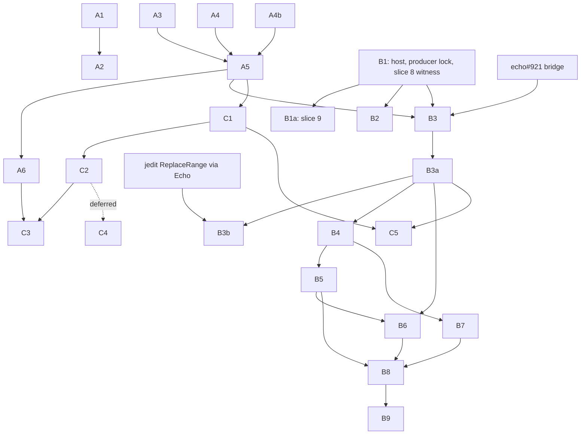

# Graft roadmap: onto Echo, with answers that state their terms

**Status:** proposal for James to accept, amend or reject. It is not adopted
yet, and it changes nothing that [`docs/BEARING.md`](docs/BEARING.md) has
locked.
**Author:** Claude (Anthropic), 2026-10-19, written against Graft `origin/main`
`1958a977`. Revised the same day to author Graft's causal parts in Edict.
Revised 2026-10-21 to apply an external design review of the A1/A3/A4 packet
and the eight decision reports; see "Review rulings".
**Relation to BEARING:** BEARING holds the current direction and the locked
slice plan through slice 9, "one structural-history migration". This roadmap
starts where slice 9 ends. It plans the rest of the move off git-warp, and a
second track that makes every answer say how complete and how current it is.

Each item below is meant to be one atomic, independently mergeable change,
with its outcome, its prerequisites and why, and what proves it done. Item
ids are for this document. When an item is adopted it becomes a METHOD
backlog card (`docs/method/backlog/<lane>/<LEGEND>_<slug>.md`).

## Where Graft stands

Each fact below was read from `main` on 2026-10-19 and checked against source.

- **git-warp is the only structural substrate in production.**
  - The dependency is `@git-stunts/git-warp` `^16.0.0` (`package.json:91`).
  - 21 files in `src/` import it. Only `src/warp/open.ts:9` imports a value;
    the rest import types.
  - Six files write structural history through `PatchBuilderV2`: `index-head`,
    `ast-emitter`, the two import resolvers, the qualified-reference resolver
    and semantic enrichment, all under `src/warp/`. `context.ts` supplies the
    builder. `index-head.ts` writes `commit:{sha}` nodes and the add, change
    and remove edges.
  - Reads go through observers, `traverse`, `getNodes`, `getEdges` and
    `worldline().seek`. Sidecar repositories and an LRU pool (`src/mcp/warp-pool.ts`) manage the handles.
- **The Echo side is scaffolding.**
  - `src/ports/structural-reading.ts` covers two readings: reference counts
    and dead symbols.
  - Its Echo adapter (`src/echo/structural-reading-adapter.ts`) is marked
    "NOT WIRED, NOT SHIPPED". It speaks `graft.echo-kernel-command.v1`, which
    no Echo build implements, and its only transport is an in-memory fake
    (`src/adapters/fake-echo-kernel-transport.ts`).
  - Both composition roots construct only the git-warp port
    (`src/mcp/server-context.ts`, `src/mcp/repo-tool-worker-context.ts`).
  - A real process transport exists only on the unmerged branch
    `cycle/real-echo-structural-history-provider` (`5b9c4a86`).
- **Parity has never been checked against Echo.**
  - The only parity test round-trips git-warp output through the generated
    model (`test/unit/echo/generated-model-parity.test.ts`).
  - `MigrationParityStatus` is `NOT_CHECKED` everywhere.
- **The planned Edict and Echo path already works elsewhere.**
  - hello-echo's workspace observer (`effect/src/observe-workspace.edict`,
    lawpack `workspace.snapshot@1`) runs through a generated Rust host that
    links `warp-core`.
  - Its full suite passed on 2026-10-19 against Echo `4e801ef2` and Edict
    `0c8cf37` (hello-echo branch `claude/advance-producers`). It covers an
    ordered golden, retry, conflict, aperture substitution, replay, a fresh
    world, refusals and observed-basis binding.
  - That is the same request, settle and replay shape as slice 8's
    `ObserveWorkspaceSnapshot`.
- **Answers state some of their terms, not all.**
  - `code_refs` reports `approximate: true`, its engine, pattern and files
    searched. But it drops matches in policy-refused or unreadable files
    without counting them (`src/mcp/tools/code-refs.ts:410-426`).
  - The committed reference scan derives `complete` or `partial` from
    warnings and resolution (`src/warp/committed-reference-scan.ts:428-435`).
    Dead symbols assert `complete` whatever the index covers
    (`src/warp/structural-reading-adapter.ts:212`), and indexing is lazy:
    there's a 64-file refusal per call (`src/warp/index-head.ts:188-194`).
  - The observation cache decides "unchanged" with 32-bit FNV-1a
    (`src/operations/observation-cache.ts:7`). Two realistic one-line files
    collide: `export const limit = 33149;` and `export const limit = 908276;`.
  - Canonical `sid:*` identity exists for indexed reads. Everything else is a
    `sym:<file>:<symbol>` address.

## What the plan depends on (2026-10-19)

- **Echo.**
  - `main` is at `f76e9007`, where #918 merged today.
  - The authored-effects design is open as echo#889. By its own text it
    "governs nothing" until merged, and it is not implemented.
  - The bridge, echo#921 ("Implement exact-parent authored graph effects"),
    is a draft with 6 of 11 plan items done. The rest bind the authored
    program, interpret effect instructions, validate effects and derive
    patches, make the work atomic with receipts and the WAL, and prove
    end-to-end editing.
- **Edict.** `main` is at `0c8cf37`. It merged today:
  - authenticated source modules and source-closure application builds
    (#252–#256);
  - a configurable causal-cell recipe (#248);
  - byte literals (#250);
  - bounded UTF-8 validation (#258);
  - ordered guard proofs (#257).

  jedit's draft still marks `use module` as `PROPOSED`. I have not checked
  whether the merged syntax matches it.
- **jedit.** Its first Edict operation landed today (jedit#302) as a draft
  reference with `PROPOSED` constructs. Its rope design, DL-0159, is a draft.
- **hello-echo.** Its suite passes against Echo `4e801ef2` and Edict `0c8cf37`
  on its branch `claude/advance-producers`. It was not run against Echo
  `f76e9007`.

## Review rulings (2026-10-21)

An external review ruled on the packet. The recommendation: make Graft's
current answers trustworthy, establish one real Echo-backed operation, and
prioritize identities, call relationships and versioned neighborhoods.

| Decision | Ruling | Path |
| --- | --- | --- |
| A3 secret counts | Enhance, then approve | Exclude confidential content before searching; define permissible metadata disclosure separately. |
| Strict schema versions | Approve | Apply the existing versioning rule; it is a defect correction. |
| A4 and reference coverage | Enhance | Tighten A4's historical scope; add A4b as a separate reference-count change. |
| Shared terms block | Enhance, then approve | Canonical, versioned terms with enforced semantics; remove the withheld indicator and the negotiation proposal. |
| Edict authorship | Approve direction; narrow scope | Edict owns admitted application transitions. Start with one workspace-observation slice. |
| Echo transport | Approve with conditions | A pinned Graft-owned Rust host; measure lifecycle choices before selecting production behavior. |
| Accepted `PARTIAL` parity | Enhance substantially | Permit demonstrated semantic corrections and equivalent representations; disclosed capability loss needs a separate decision. |
| C4 cost analysis | Approve ownership; defer implementation | Graft owns it. Prioritize C1 to C3. |

Path forward:
- **Now:** correct secret disclosure (A3, A3b), apply the schema bumps,
  qualify A4's temporal scope, and stop fallback readings from claiming an
  unsupported basis. (Done on the A3, A4 and `code_find` branches.)
- **Next:** A4b, then consolidate the demonstrated answer contracts into A5.
- **Alongside:** one pinned, recoverable workspace-observation slice through
  the real host (B1 below).
- **Preserve:** independent progress on C1 to C3 wherever actual
  prerequisites permit.
- **Later:** richer cost analysis; consuming Edict verification artifacts as
  explicitly labeled evidence.
- **Never:** make "Echo-native" synonymous with "true".

## Principles

1. **Parity before cutover, measured per surface.** No surface leaves
   git-warp until fixtures show its Echo answer `MATCHED`, or every
   difference is an accepted, demonstrated difference of an eligible class:

   | Difference | Cutover treatment |
   | --- | --- |
   | Equivalent representation with preserved meaning | Eligible with a demonstrated mapping. |
   | Correction of a known false claim | Eligible with independent expected results. |
   | Stronger evidence or broader coverage | Eligible after checking existing behavior remains valid. |
   | A previously supported fact or query becomes unavailable | A separate capability-removal decision, not parity acceptance. Disclosure makes a loss visible; it does not preserve capability. |
   | Unexplained mismatch | Blocks cutover. |

   Comparisons fix every input: workspace state, policy, query parameters,
   analysis versions and relevant imported history; "same Git commit" is not
   enough. Normalization stays narrow: identities, ordering, basis and
   coverage are compared, not removed because they differ. The comparison
   result ("partial coverage" describes an answer) is recorded separately
   from the owner's acceptance record ("accepted difference" is a migration
   decision). Each accepted difference is tied to a fixture and a specific
   contract; when it disappears, the stale exception is removed after review.
2. **Don't hand-translate git-warp's graph into Echo** (BEARING, "git-warp
   Substrate Strain"). Echo stores facts defined by
   `schemas/graft-structural-history.graphql`. git-warp history comes in as
   evidence labelled `git-warp-imported`; it is not the target model.
3. **Every answer states its terms,** in the dimensions that apply to it:
   - basis: exact source revision or observed workspace state, plus relevant
     analysis configuration;
   - domain: languages, relation kinds, paths, history interval and counting
     unit covered by the claim, with requested and evaluated scope kept
     distinct;
   - evidence coverage: which required inputs were examined, missing,
     unavailable or unknown;
   - analysis limitations: unsupported syntax, unresolved references, parse
     failures and other semantic gaps;
   - delivery: whether results are truncated or paginated, even when analysis
     completed;
   - evidence origin: parser-submitted, imported or runtime-recorded, and what
     was actually verified.

   Completeness is derived, never asserted, and unknown evidence stays
   unknown. Confidential content never influences an answer: not its matches,
   counts, refusals, sizes or errors.

   Evidence labels (`echo-native`, `git-warp-imported`, `fallback-translated`)
   say where a fact came from. Terms say how far it can be trusted.
4. **Edict defines Graft's admitted application transitions and their domain
   obstructions. Adapters supply observations; Echo enforces and records the
   transition.** Echo's ADR-0014 forbids hand-written native rules as an
   application authoring path. "Everything that decides what Graft records"
   is too broad: parsing decides which candidate facts exist, and parsing
   stays outside Edict.
   - Parsing and extraction stay in TypeScript. Parser facts bind to the
     observed source bytes and to the parser and extractor versions.
   - Parse the bytes actually observed. Recording a digest and then rereading
     a mutable file for parsing can bind facts to the wrong content.
   - Edict validates and admits those facts under Graft's rules.
   - Runtime enforcement stays: compiler acceptance and runtime validation
     establish different things.
   - A crashed host or broken transport is an infrastructure failure, never a
     fabricated application obstruction.

   Later gates require demonstrated capabilities, not merged PR numbers, and
   need only the Edict and Echo features the operation actually uses.
   Text search, MCP and CLI surfaces, rendering and the daemon stay in
   TypeScript. Echo is reached through a pinned host that runs
   the compiled packages, as hello-echo does, not through a hand-written
   protocol shim.
5. **Each item merges on its own and leaves `main` working.**
6. **"Echo-native" is not a synonym for "true".** An Echo-native reading
   still states its terms; provenance is not correctness.

## Track A: answers that state their terms

This track is independent of the substrate. Do it first: it is cheap, and it
makes Echo parity checkable.

| Id | Outcome | Prerequisites | Done when |
| --- | --- | --- | --- |
| A1 | The observation cache identifies content by SHA-256 (existing card `CORE_observation-cache-32-bit-content-hash`) | none | A test with the colliding pair above sees the second read as changed |
| A2 | Reread suppression depends on a per-consumer delivery ledger, not a cache hit (existing card `CORE_reread-suppression-trusts-cache-as-delivery`, with the `CORE_unchanged-outline-notice` design) | A1, so the ledger's identity and the cache's agree | A cache filled by `file_outline` never suppresses a `safe_read` the consumer didn't receive |
| A3 | `code_refs` reports what it omitted for relevance (by count and reason) and never searches confidential files, counting them nowhere; schema `3.0.0` | none | Paired repositories differing only in a confidential file's content or existence answer identically, call for call, with visible, empty, refused, scoped and warm-cache calls; the advertised version's validator accepts the payload |
| A3b | `code_find` never parses or returns confidential files, on the live and WARP paths | none (shares the policy refactor with A3; either may land first) | The same paired-repository property for `code_find` |
| A4 | Dead symbols derive `complete` from current-tree coverage and state their history domain separately: observed index boundaries examined, and that changes between boundaries are unobserved; removals are located between boundaries, not at a claimed removing commit; fallback reference readings stop claiming the requested ref; schemas `2.0.0` | none | A partly indexed fixture reports `partial` and names the unindexed files; a symbol removed at an unindexed commit names the boundaries around it |
| A4b | Reference counts state their terms: the unit is distinct other files referencing the symbol (not call sites, occurrences or runtime callers); domain, coverage and actual basis; `graft_blame` and `graft_difficulty` routed through the port | none recorded; add A4 only if the design reuses A4's index coverage | A never-indexed referencing file makes `graft_blame` report `partial`; a YAML mention is excluded and the scan stays `complete`; a fallback never claims a basis it did not answer at |
| A5 | Canonical, versioned answer terms with enforced semantics, generalized from A3, A4 and A4b, in the dimensions of principle 3; no secret-dependent withheld indicator and no negotiation | A3, A4, A4b, so the terms describe demonstrated contracts | Contradictory terms are rejected on the generation and admission paths, not only declared with `@wes_invariant`; legacy readings stay unknown; requested and evaluated scope stay distinct; Continuum's actual contract was read before claiming alignment |
| A6 | An invalidation fixture: a three-file repository with controlled mutations | A5 | Each mutation invalidates exactly the expected readings, and any over- or under-invalidation fails the test |

A6's mutations:
- a new caller of an unchanged function;
- an upstream dispatch change;
- a move between files;
- an unrelated edit in the same file;
- a rename;
- an unresolvable dynamic dispatch.

## Track B: off git-warp, onto Echo, authored in Edict

BEARING slices 8 and 9 come first, unchanged; slice 8's
`ObserveWorkspaceSnapshot` is already an Edict operation. B items continue
from slice 9.

**The pathfinder is jedit.** jedit is making the same move for text, a few
steps ahead.
- **Its model.** jedit design DL-0159 makes every structural relation an Echo
  edge. Immutable nodes are content-addressed over their facts and ordered
  children, so unchanged subtrees keep their identity across edits, and every
  head is anchored to a file coordinate and the digest of its imported bytes.
- **Its first operation.** jedit's first Edict operation landed on 2026-10-19
  (jedit#302, `edict/replace-range/draft/Reference.edict`). It reads typed
  facts and edges, `ensure`s content-addressed nodes, and retargets the
  canonical head edge by compare-and-swap. Several of those constructs are
  still marked `PROPOSED` in that file.

Graft's structural history should use the same model, and wait for the same
machinery rather than invent its own.

| Id | Outcome | Prerequisites | Done when |
| --- | --- | --- | --- |
| B1 | **One integration milestone: the minimum host, the producer lock and the first observation witness** (formerly B0's slice 8, B1 and B2's lock, which waited on each other). A Graft-owned Rust host built from a template against pinned Echo and Edict commits, a fail-closed `producers.lock.json`, and slice 8's workspace observation as one complete slice: observe source, submit an authored operation, obtain a receipt, restart, and recover the same evidence. The process boundary separates APIs and failure domains; it is not a security sandbox, and while both processes keep the same filesystem authority it does not stop the TypeScript process from touching the WAL, so the enforced boundary is described as exactly that | slice 7 (shipped) | The slice replays after restart with the same evidence; producer and package identities are pinned before results are interpreted; installation, scheduler controls and WAL paths are never in app requests; request and response sizes are bounded; diagnostics stay off protocol stdout; Echo's writer ownership and fencing are used; a host that commits but loses its response is retried with the original occurrence identity and recovers that outcome, never creating a second operation; the fake and the real host pass one conformance suite including framing, concurrency, shutdown and ambiguous completion |
| B1a | Slice 9 as BEARING defines it: one history or blame surface behind the port | B1 | As BEARING's packet says |
| B2 | **Lifecycle measured, not assumed.** Start per-call; measure startup and recovery against representative retained histories (a tiny fresh WAL is not a lifecycle benchmark) before choosing a long-lived host; one shared Cargo target directory for every generated host | B1 | Measurements recorded; a change of lifecycle passes the same conformance suite, since persistence changes more than the adapter |
| B3 | **A structural-history lawpack and data model in Edict.** Content-addressed nodes for files, symbols and their children (DL-0159's rope pattern); a head per indexed file, anchored to its path and byte digest; a canonical repository head retargeted by compare-and-swap; the facts typed by `schemas/graft-structural-history.graphql` through Wesley | echo#921 merged, because Edict can't write effects until the bridge exists; the Edict features jedit's reference marks `PROPOSED` and B3 needs (typed edge reads, edge `ensure`, compare-and-retarget, canonical encode) available on Edict `main`; A5, so facts carry their terms | The lawpack compiles against pinned Edict and Echo; a fixture of one file round-trips: ensure, then read back the same facts; re-ensuring an unchanged symbol reuses its node id |
| B3a | **Indexing as an Edict operation.** The host parses with tree-sitter over a settled workspace observation (B0) and submits the result; an Edict intent admits it by `ensure`-ing nodes and edges and retargeting the file head. git-warp stays the default behind a selector | B3; B1, B2 | For a fixture repository, the Echo index holds the same facts as git-warp's, compared by schema value, not graph shape; an edit to one function changes that function's node and its ancestors' ids, and no others |
| B3b | **`graft_edit` as an Edict operation,** following jedit's ReplaceRange: basis head, a range or exact `old_string` precondition, typed obstructions, a new head. Jedit's in-Echo text edit is not proof for filesystem bytes: external edits need stale-content checks and crash reconciliation between the file effect and its recorded outcome | B3a; the capabilities jedit's ReplaceRange demonstrates through Echo, as far as this operation needs them | Every existing `graft_edit` refusal becomes a typed obstruction with the same meaning; a stale basis is refused, not applied; an external edit between check and write is detected; a crash between the file write and the recorded outcome reconciles |
| B4 | **Executable parity harness.** It runs every structural surface against both substrates on fixed inputs and records the comparison per difference, separately from the owner's acceptance record, classified as in principle 1 | B3a | The harness is in CI; each difference is tied to a fixture and a contract; an unexplained mismatch fails CI; a capability loss cannot be accepted as parity |
| B5 | **Surfaces move one at a time** behind `StructuralReadingPort`, in order of git-warp strain: references and dead symbols, blame, log and churn, refactor difficulty, precision, then symbol timeline | B4, with `MATCHED` for that surface | Each surface's normal path opens no git-warp handle (a retirement test per surface, as the migration design asks) |
| B6 | **Local history** (`persisted-local-history*`, the local history DAG) is retained in Echo worldlines, one per worktree and actor lane, replacing sidecar repositories. Its ticks and strand admission are Edict operations | B3a; B5 for the readers that use it | Restart replay reproduces the local history view with zero git-warp opens |
| B7 | **git-warp history import.** A one-way import of existing git-warp history as `git-warp-imported` evidence, with provenance kept | B4, so imported facts can be checked against it | Imported readings carry the label and their source commit; nothing is re-labelled `echo-native` |
| B8 | **Cutover.** Echo becomes the default; git-warp opens only through an explicit fallback that labels results `fallback-translated`. Fallback is not automatic rollback: once Echo accepts new authoritative history, switching to an old git-warp view can lose it unless a reverse path exists | B5 complete for every surface; B6; B7 | With the fallback off, the full suite and the parity harness open no git-warp handle; the rollback story is stated |
| B9 | **Removal.** `@git-stunts/git-warp` and the sidecar and pool code are removed | B8, plus one release of fallback telemetry showing no fallback reads | `package.json` no longer lists it, and the release independence test asserts it |

Resource note for B6 and B8: a git-warp handle has been measured at 102.51 MiB
(`WARP_resident-count-is-not-a-memory-budget`). Echo worldlines need a byte
budget from the start, not a resident count.

## Track C: structure beyond names

Each item needs its terms from track A. Without them, more structure only
makes answers look more certain. Priority is C1 identity, then C2 call
relationships, then C3 versioned neighbourhoods; these are what give an agent
the context its task needs. C4 must not become a prerequisite for useful
answers.

| Id | Outcome | Prerequisites | Done when |
| --- | --- | --- | --- |
| C1 | Canonical identity on every reading that names a symbol, not only indexed reads; unindexed symbols say so. Under B3's content-addressed model, a node id is the content identity, and lineage follows file heads; `sid:*` becomes the name for a symbol's lineage across heads | A5; B3 if identity is recorded in Echo | No reading returns a bare `sym:` address without saying it is non-canonical |
| C2 | A resolved call graph: call edges from the qualified-reference resolver, with unresolved and dynamic edges kept as such, not dropped | A5; C1 | A6's dynamic-dispatch mutation reports "possible targets: N, unresolved" rather than a short exact list |
| C3 | Versioned neighbourhoods: a reading of a symbol's neighbourhood names the node, edge and coverage versions it depends on, so an upstream change invalidates it without its bytes changing. Consider versioning body, interface, incoming callers, outgoing dependencies and resolution context separately, with evidence for absence | C2; A6 | A6's upstream-dispatch mutation invalidates the neighbourhood reading and nothing else |
| C4 | **Static cost and memory marks (deferred).** Graft owns it; Edict keeps checking its own declared budgets. Start with loop and call-site annotations; symbolic costs such as `n × m` with cardinality assumptions stated; unresolved dependencies kept explicit; separate labels for heuristics, bounds established under stated assumptions, and measured observations. "No bound found" means unknown, not proven unbounded; nested loops alone do not prove superlinear work; a Rust type size is not a stack bound. Compiler-assisted analysis needs an explicit, isolated execution boundary, because Cargo builds can run `build.rs` | C2; scheduled after C1 to C3 | On a fixture with a nested loop over two collections derived from one input, the path is annotated with its loop sites and a symbolic cost under stated assumptions, labelled as such |
| C5 | History links: a structural fact linked to the commits and pull requests that introduced or changed it, with intent (pull request text) kept apart from implementation evidence | C1; B3 | A reading can answer "which change made this path reachable", and labels pull-request text as intent |

## Order

These have no prerequisites and can start in parallel: A1, A3, A3b, A4, A4b
and B1. None of them blocks another. A3 and A3b share one policy refactor
commit; whichever lands second merges it cleanly.

## Decisions for James

Ruled on 2026-10-21; see "Review rulings". The original questions follow.

1. **Which causal parts move into Edict, and when.** I propose all five
   listed under principle 4, each after echo#921 and in jedit's wake. The
   alternative, native Echo rules in a Graft host, is faster to start, but
   Echo's ADR-0014 rules it out as a public authoring path.
2. **The Echo transport for B1.** The options:
   - a Graft-owned Rust host process, which is what hello-echo proves works;
   - Echo's `warp-wasm` in process;
   - a long-lived Echo daemon.

   I'd take the host process, because hello-echo proves it end to end today
   and the unmerged TypeScript side already speaks to a process. The
   protocol it speaks still has to be defined on Echo's side.
3. **Whether the terms block (A5) belongs in the structural-history schema,**
   making it part of every reading's contract. I think it should.
4. **Whether `PARTIAL` parity may ship.** That would allow a surface to move
   to Echo with a named, accepted difference, rather than requiring
   `MATCHED`.
5. **Whether C4 (static cost and memory) belongs in Graft or in Edict.** For
   Edict-authored rules, declared step and size budgets already make some of
   it a checked contract rather than an inference.

## Out of scope

- BEARING's held work, unchanged.
- Daemon dashboards, live-frontier work and a general Continuum redesign.
- Rewriting Graft in Rust. The integration requirements doc keeps that
  question separate.
