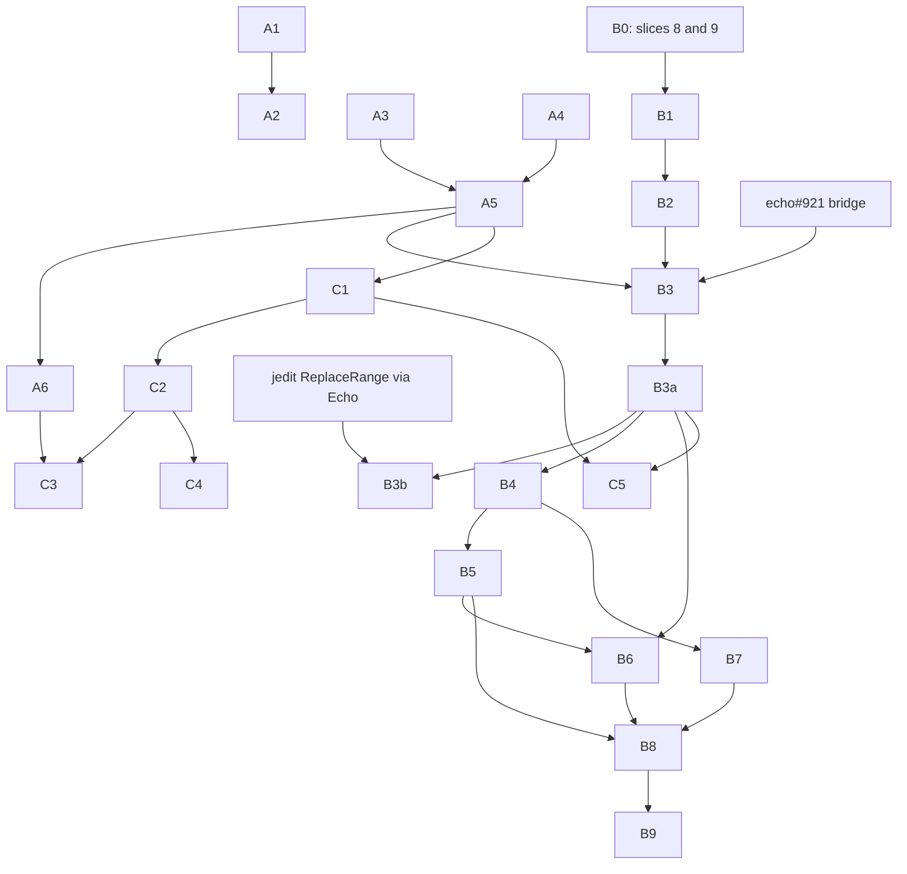

# Graft roadmap: onto Echo, with answers that state their terms

**Status:** proposal for James to accept, amend or reject. It is not adopted
yet, and it changes nothing that [`docs/BEARING.md`](docs/BEARING.md) has
locked.
**Author:** Claude (Anthropic), 2026-10-19, written against Graft `origin/main`
`1958a977`. Revised the same day to author Graft's causal parts in Edict.
**Relation to BEARING:** BEARING holds the current direction and the locked
slice plan through slice 9, "one structural-history migration". This roadmap
starts where slice 9 ends. It plans the rest of the move off git-warp, and a
second track that makes every answer say how complete and how current it is.

Each item below is meant to be one atomic, independently mergeable change,
with its outcome, its prerequisites and why, and what proves it done. Item
ids are for this document. When an item is adopted it becomes a METHOD
backlog card (`docs/method/backlog/<lane>/<LEGEND>_<slug>.md`).

## Where Graft stands

Each fact below was read from `main` on 2026-10-19 and checked against source.

- **git-warp is the only structural substrate in production.**
  - The dependency is `@git-stunts/git-warp` `^16.0.0` (`package.json:91`).
  - 21 files in `src/` import it. Only `src/warp/open.ts:9` imports a value;
    the rest import types.
  - Six files write structural history through `PatchBuilderV2`: `index-head`,
    `ast-emitter`, the two import resolvers, the qualified-reference resolver
    and semantic enrichment, all under `src/warp/`. `context.ts` supplies the
    builder. `index-head.ts` writes `commit:{sha}` nodes and the add, change
    and remove edges.
  - Reads go through observers, `traverse`, `getNodes`, `getEdges` and
    `worldline().seek`. Sidecar repositories and an LRU pool (`src/mcp/warp-pool.ts`) manage the handles.
- **The Echo side is scaffolding.**
  - `src/ports/structural-reading.ts` covers two readings: reference counts
    and dead symbols.
  - Its Echo adapter (`src/echo/structural-reading-adapter.ts`) is marked
    "NOT WIRED, NOT SHIPPED". It speaks `graft.echo-kernel-command.v1`, which
    no Echo build implements, and its only transport is an in-memory fake
    (`src/adapters/fake-echo-kernel-transport.ts`).
  - Both composition roots construct only the git-warp port
    (`src/mcp/server-context.ts`, `src/mcp/repo-tool-worker-context.ts`).
  - A real process transport exists only on the unmerged branch
    `cycle/real-echo-structural-history-provider` (`5b9c4a86`).
- **Parity has never been checked against Echo.**
  - The only parity test round-trips git-warp output through the generated
    model (`test/unit/echo/generated-model-parity.test.ts`).
  - `MigrationParityStatus` is `NOT_CHECKED` everywhere.
- **The planned Edict and Echo path already works elsewhere.**
  - hello-echo's workspace observer (`effect/src/observe-workspace.edict`,
    lawpack `workspace.snapshot@1`) runs through a generated Rust host that
    links `warp-core`.
  - Its full suite passed on 2026-10-19 against Echo `4e801ef2` and Edict
    `0c8cf37` (hello-echo branch `claude/advance-producers`). It covers an
    ordered golden, retry, conflict, aperture substitution, replay, a fresh
    world, refusals and observed-basis binding.
  - That is the same request, settle and replay shape as slice 8's
    `ObserveWorkspaceSnapshot`.
- **Answers state some of their terms, not all.**
  - `code_refs` reports `approximate: true`, its engine, pattern and files
    searched. But it drops matches in policy-refused or unreadable files
    without counting them (`src/mcp/tools/code-refs.ts:410-426`).
  - The committed reference scan derives `complete` or `partial` from
    warnings and resolution (`src/warp/committed-reference-scan.ts:428-435`).
    Dead symbols assert `complete` whatever the index covers
    (`src/warp/structural-reading-adapter.ts:212`), and indexing is lazy:
    there's a 64-file refusal per call (`src/warp/index-head.ts:188-194`).
  - The observation cache decides "unchanged" with 32-bit FNV-1a
    (`src/operations/observation-cache.ts:7`). Two realistic one-line files
    collide: `export const limit = 33149;` and `export const limit = 908276;`.
  - Canonical `sid:*` identity exists for indexed reads. Everything else is a
    `sym:<file>:<symbol>` address.

## What the plan depends on (2026-10-19)

- **Echo.**
  - `main` is at `f76e9007`, where #918 merged today.
  - The authored-effects design is open as echo#889. By its own text it
    "governs nothing" until merged, and it is not implemented.
  - The bridge, echo#921 ("Implement exact-parent authored graph effects"),
    is a draft with 6 of 11 plan items done. The rest bind the authored
    program, interpret effect instructions, validate effects and derive
    patches, make the work atomic with receipts and the WAL, and prove
    end-to-end editing.
- **Edict.** `main` is at `0c8cf37`. It merged today:
  - authenticated source modules and source-closure application builds
    (#252–#256);
  - a configurable causal-cell recipe (#248);
  - byte literals (#250);
  - bounded UTF-8 validation (#258);
  - ordered guard proofs (#257).

  jedit's draft still marks `use module` as `PROPOSED`. I have not checked
  whether the merged syntax matches it.
- **jedit.** Its first Edict operation landed today (jedit#302) as a draft
  reference with `PROPOSED` constructs. Its rope design, DL-0159, is a draft.
- **hello-echo.** Its suite passes against Echo `4e801ef2` and Edict `0c8cf37`
  on its branch `claude/advance-producers`. It was not run against Echo
  `f76e9007`.

## Principles

1. **Parity before cutover, measured per surface.** No surface leaves
   git-warp until a fixture shows its Echo answer `MATCHED`. Where it differs,
   it is recorded `PARTIAL` with the difference named.
2. **Don't hand-translate git-warp's graph into Echo** (BEARING, "git-warp
   Substrate Strain"). Echo stores facts defined by
   `schemas/graft-structural-history.graphql`. git-warp history comes in as
   evidence labelled `git-warp-imported`; it is not the target model.
3. **Every answer states its terms:**
   - its basis: commit, working-tree state and index version;
   - its domain: what was searched;
   - what it skipped, and why;
   - whether it is complete, derived from coverage rather than asserted.

   Evidence labels (`echo-native`, `git-warp-imported`, `fallback-translated`)
   say where a fact came from. Terms say how far it can be trusted.
4. **Graft's causal parts are authored in Edict.** Echo's ADR-0014 forbids
   hand-written native rules as an application authoring path, and Echo's
   proposed authored-effects design (echo#889, bridge in progress as echo#921)
   lets compiled Edict read Echo facts and propose graph effects directly.
   "Causal" means everything that decides what Graft records or changes, and
   on what basis:
   - workspace observations;
   - admitting structural facts;
   - edits;
   - local-history ticks and strand admission;
   - the obstructions a reading returns when its terms aren't met.

   Parsing (tree-sitter), text search, MCP and CLI surfaces, rendering and the
   daemon stay in TypeScript. Echo is reached through a pinned host that runs
   the compiled packages, as hello-echo does, not through a hand-written
   protocol shim.
5. **Each item merges on its own and leaves `main` working.**

## Track A: answers that state their terms

This track is independent of the substrate. Do it first: it is cheap, and it
makes Echo parity checkable.

| Id | Outcome | Prerequisites | Done when |
| --- | --- | --- | --- |
| A1 | The observation cache identifies content by SHA-256 (existing card `CORE_observation-cache-32-bit-content-hash`) | none | A test with the colliding pair above sees the second read as changed |
| A2 | Reread suppression depends on a per-consumer delivery ledger, not a cache hit (existing card `CORE_reread-suppression-trusts-cache-as-delivery`, with the `CORE_unchanged-outline-notice` design) | A1, so the ledger's identity and the cache's agree | A cache filled by `file_outline` never suppresses a `safe_read` the consumer didn't receive |
| A3 | `code_refs` reports what it skipped: refused and unreadable files, by count and reason | none | A fixture with one refused file shows `skipped` and keeps `total` honest |
| A4 | Dead symbols and reference counts derive `complete` from coverage: the share of candidate files indexed, plus unsupported semantics | none | A partly indexed fixture reports `partial` and names the unindexed files |
| A5 | A shared **terms** block (basis, domain, skipped, completeness, blind spots) in the structural-history schema and the `StructuralReadingPort` contract | A3, A4, so the block describes real fields | Every port result validates against it; a result can't say `complete` with a non-empty `skipped` |
| A6 | An invalidation fixture: a three-file repository with controlled mutations | A5 | Each mutation invalidates exactly the expected readings, and any over- or under-invalidation fails the test |

A6's mutations:
- a new caller of an unchanged function;
- an upstream dispatch change;
- a move between files;
- an unrelated edit in the same file;
- a rename;
- an unresolvable dynamic dispatch.

## Track B: off git-warp, onto Echo, authored in Edict

BEARING slices 8 and 9 come first, unchanged; slice 8's
`ObserveWorkspaceSnapshot` is already an Edict operation. B items continue
from slice 9.

**The pathfinder is jedit.** jedit is making the same move for text, a few
steps ahead.
- **Its model.** jedit design DL-0159 makes every structural relation an Echo
  edge. Immutable nodes are content-addressed over their facts and ordered
  children, so unchanged subtrees keep their identity across edits, and every
  head is anchored to a file coordinate and the digest of its imported bytes.
- **Its first operation.** jedit's first Edict operation landed on 2026-10-19
  (jedit#302, `edict/replace-range/draft/Reference.edict`). It reads typed
  facts and edges, `ensure`s content-addressed nodes, and retargets the
  canonical head edge by compare-and-swap. Several of those constructs are
  still marked `PROPOSED` in that file.

Graft's structural history should use the same model, and wait for the same
machinery rather than invent its own.

| Id | Outcome | Prerequisites | Done when |
| --- | --- | --- | --- |
| B0 | Slices 8 and 9 as BEARING defines them: retained workspace observation through Edict and Echo, then one history or blame surface behind the port | slice 7 (shipped) | As BEARING's packets say; slice 8's replay with zero filesystem reads and zero git-warp opens |
| B1 | **A real Echo host.** A Graft-owned Rust host, built like hello-echo's from a template against pinned Echo and Edict commits. It implements the kernel-command protocol over `warp-core` and replaces the in-memory fake behind `EchoKernelTransport`, finishing branch `5b9c4a86` | B0's slice 8, which defines the operations the host must serve; a decision on the transport (see Decisions) | The fake and the real host pass the same transport conformance suite; the host builds in CI from the producer pins |
| B2 | **Pinned producers.** `producers.lock.json` with Echo and Edict commits and a fail-closed check, as hello-echo has, plus a shared Cargo target directory for every generated host | B1 | A mismatched or dirty producer refuses the build; one target directory, not one per host (hello-echo's two lint targets cost about 1 GB) |
| B3 | **A structural-history lawpack and data model in Edict.** Content-addressed nodes for files, symbols and their children (DL-0159's rope pattern); a head per indexed file, anchored to its path and byte digest; a canonical repository head retargeted by compare-and-swap; the facts typed by `schemas/graft-structural-history.graphql` through Wesley | echo#921 merged, because Edict can't write effects until the bridge exists; the Edict features jedit's reference marks `PROPOSED` and B3 needs (typed edge reads, edge `ensure`, compare-and-retarget, canonical encode) available on Edict `main`; A5, so facts carry their terms | The lawpack compiles against pinned Edict and Echo; a fixture of one file round-trips: ensure, then read back the same facts; re-ensuring an unchanged symbol reuses its node id |
| B3a | **Indexing as an Edict operation.** The host parses with tree-sitter over a settled workspace observation (B0) and submits the result; an Edict intent admits it by `ensure`-ing nodes and edges and retargeting the file head. git-warp stays the default behind a selector | B3; B1, B2 | For a fixture repository, the Echo index holds the same facts as git-warp's, compared by schema value, not graph shape; an edit to one function changes that function's node and its ancestors' ids, and no others |
| B3b | **`graft_edit` as an Edict operation,** following jedit's ReplaceRange: basis head, a range or exact `old_string` precondition, typed obstructions, a new head | B3a; jedit's ReplaceRange proven through Echo, so Graft reuses a working pattern | Every existing `graft_edit` refusal becomes a typed obstruction with the same meaning; a stale basis is refused, not applied |
| B4 | **Executable parity harness.** It runs every structural surface against both substrates on fixture repositories and records `MATCHED`, `MISMATCHED` or `PARTIAL` per surface in the schema's parity field | B3a | The harness is in CI; each surface has a recorded status; a mismatch fails CI unless it is recorded as accepted `PARTIAL` with a reason |
| B5 | **Surfaces move one at a time** behind `StructuralReadingPort`, in order of git-warp strain: references and dead symbols, blame, log and churn, refactor difficulty, precision, then symbol timeline | B4, with `MATCHED` for that surface | Each surface's normal path opens no git-warp handle (a retirement test per surface, as the migration design asks) |
| B6 | **Local history** (`persisted-local-history*`, the local history DAG) is retained in Echo worldlines, one per worktree and actor lane, replacing sidecar repositories. Its ticks and strand admission are Edict operations | B3a; B5 for the readers that use it | Restart replay reproduces the local history view with zero git-warp opens |
| B7 | **git-warp history import.** A one-way import of existing git-warp history as `git-warp-imported` evidence, with provenance kept | B4, so imported facts can be checked against it | Imported readings carry the label and their source commit; nothing is re-labelled `echo-native` |
| B8 | **Cutover.** Echo becomes the default; git-warp opens only through an explicit fallback that labels results `fallback-translated` | B5 complete for every surface; B6; B7 | With the fallback off, the full suite and the parity harness open no git-warp handle |
| B9 | **Removal.** `@git-stunts/git-warp` and the sidecar and pool code are removed | B8, plus one release of fallback telemetry showing no fallback reads | `package.json` no longer lists it, and the release independence test asserts it |

Resource note for B6 and B8: a git-warp handle has been measured at 102.51 MiB
(`WARP_resident-count-is-not-a-memory-budget`). Echo worldlines need a byte
budget from the start, not a resident count.

## Track C: structure beyond names

Each item needs its terms from track A. Without them, more structure only
makes answers look more certain.

| Id | Outcome | Prerequisites | Done when |
| --- | --- | --- | --- |
| C1 | Canonical identity on every reading that names a symbol, not only indexed reads; unindexed symbols say so. Under B3's content-addressed model, a node id is the content identity, and lineage follows file heads; `sid:*` becomes the name for a symbol's lineage across heads | A5; B3 if identity is recorded in Echo | No reading returns a bare `sym:` address without saying it is non-canonical |
| C2 | A resolved call graph: call edges from the qualified-reference resolver, with unresolved and dynamic edges kept as such, not dropped | A5; C1 | A6's dynamic-dispatch mutation reports "possible targets: N, unresolved" rather than a short exact list |
| C3 | Versioned neighbourhoods: a reading of a symbol's neighbourhood names the node, edge and coverage versions it depends on, so an upstream change invalidates it without its bytes changing | C2; A6 | A6's upstream-dispatch mutation invalidates the neighbourhood reading and nothing else |
| C4 | **Static cost and memory marks.** Each call edge marked with how often it can run (in a loop over a collection, or recursive), and each allocation site marked the same way, folded along paths into per-path bounds; unbounded and unknown bounds say why. For Rust, type sizes from the compiler and stack bounds along the call graph | C2 | On a fixture with a nested loop over two collections derived from one input, the path is flagged superlinear, with its loop sites |
| C5 | History links: a structural fact linked to the commits and pull requests that introduced or changed it, with intent (pull request text) kept apart from implementation evidence | C1; B3 | A reading can answer "which change made this path reachable", and labels pull-request text as intent |

## Order

These have no prerequisites and can start in parallel: A1, A3, A4 and B0.
None of them blocks another.

## Decisions for James

1. **Which causal parts move into Edict, and when.** I propose all five
   listed under principle 4, each after echo#921 and in jedit's wake. The
   alternative, native Echo rules in a Graft host, is faster to start, but
   Echo's ADR-0014 rules it out as a public authoring path.
2. **The Echo transport for B1.** The options:
   - a Graft-owned Rust host process, which is what hello-echo proves works;
   - Echo's `warp-wasm` in process;
   - a long-lived Echo daemon.

   I'd take the host process, because hello-echo proves it end to end today
   and the unmerged TypeScript side already speaks to a process. The
   protocol it speaks still has to be defined on Echo's side.
3. **Whether the terms block (A5) belongs in the structural-history schema,**
   making it part of every reading's contract. I think it should.
4. **Whether `PARTIAL` parity may ship.** That would allow a surface to move
   to Echo with a named, accepted difference, rather than requiring
   `MATCHED`.
5. **Whether C4 (static cost and memory) belongs in Graft or in Edict.** For
   Edict-authored rules, declared step and size budgets already make some of
   it a checked contract rather than an inference.

## Out of scope

- BEARING's held work, unchanged.
- Daemon dashboards, live-frontier work and a general Continuum redesign.
- Rewriting Graft in Rust. The integration requirements doc keeps that
  question separate.
